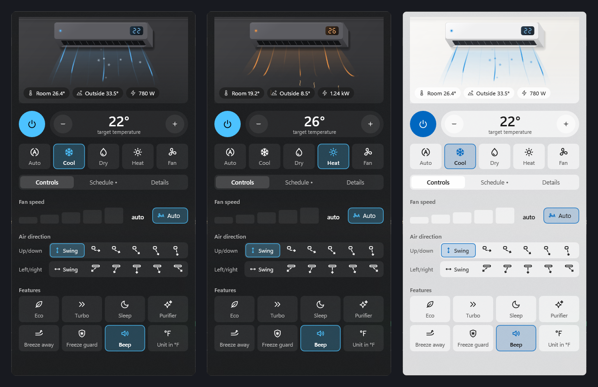
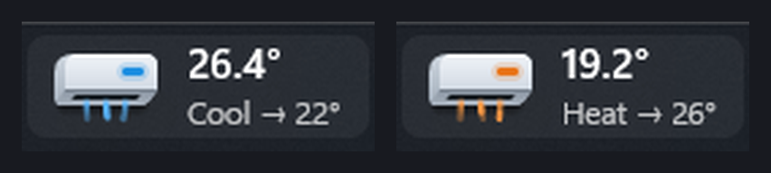
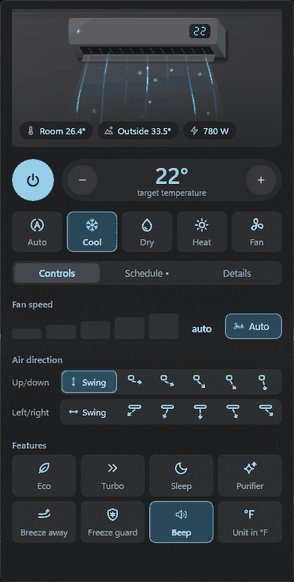
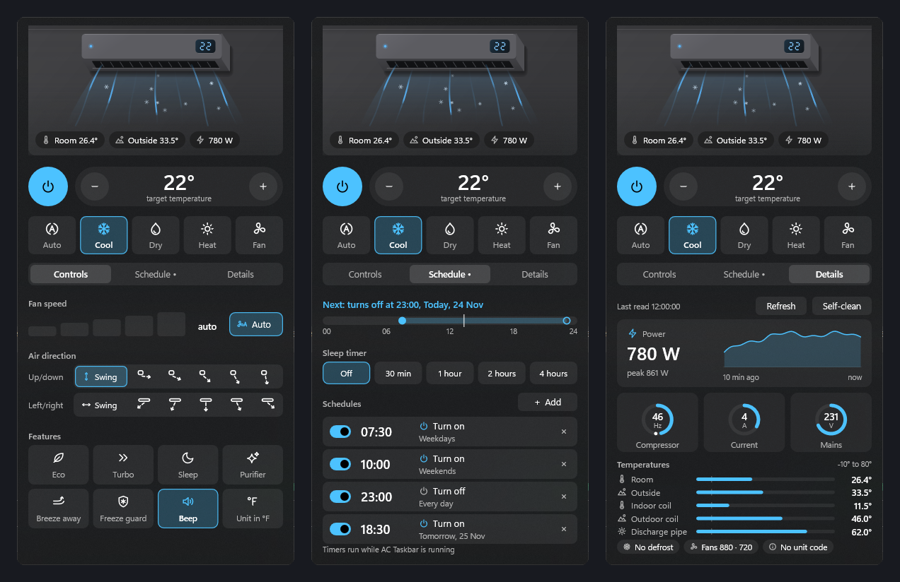
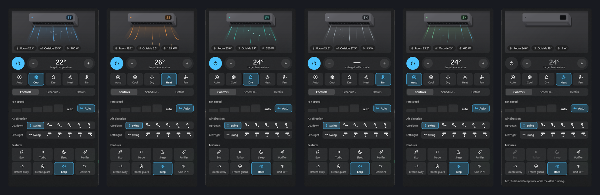
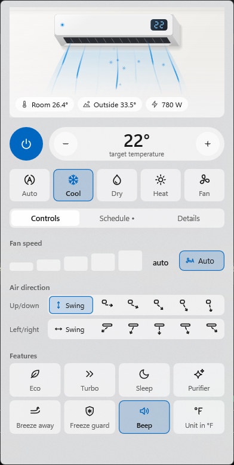
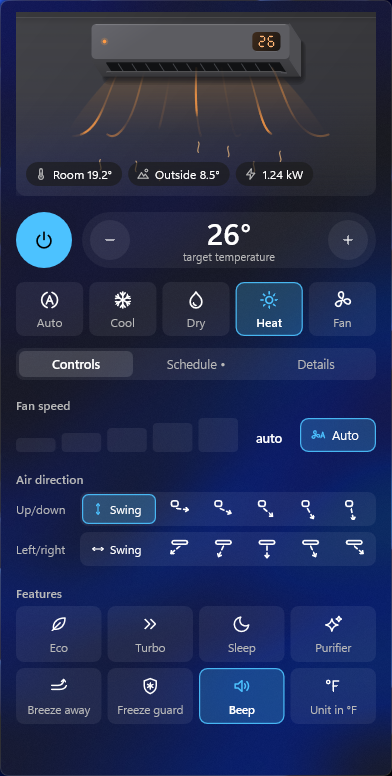
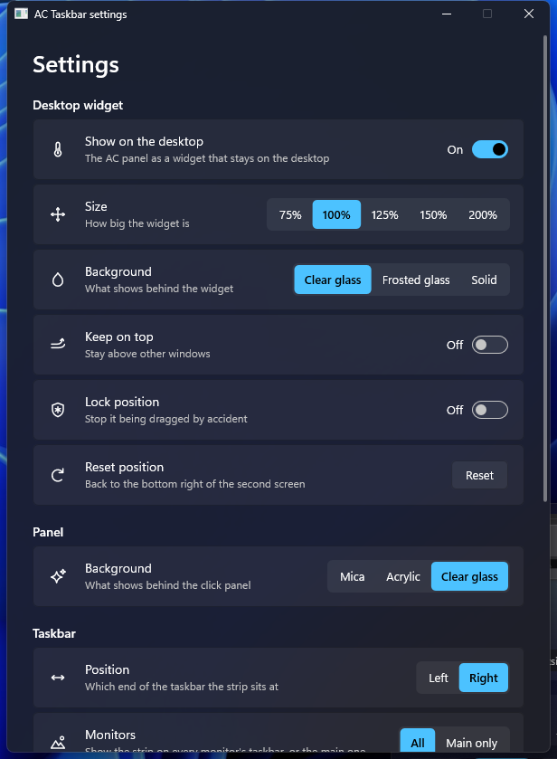
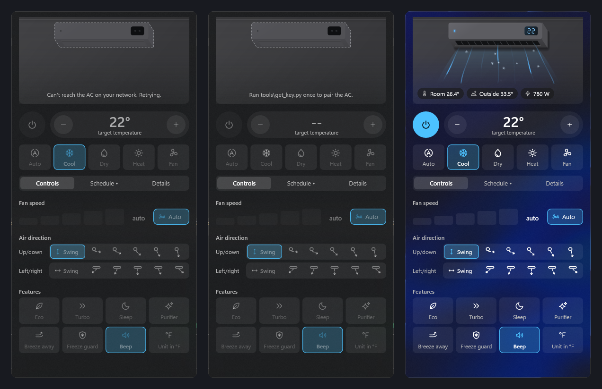

# AC Taskbar

**A Midea air conditioner on your Windows taskbar.** A small strip shows what the AC is doing at a glance; one click opens a full control panel; the same panel can live on your desktop as a widget. It talks to the unit **directly over your local network** (Midea LAN protocol V3), with no cloud in the loop after a one-time key fetch.

<p align="center"></p>

Written in plain C++17 and Win32/Direct2D: no runtime, no Electron, one small `.exe`. Inspired by [open-battery](https://github.com/wachi35676/open-battery); the protocol work builds on [msmart-ng](https://github.com/mill1000/midea-msmart) (MIT).

## What you get

### At a glance: the taskbar strip

A 3D, Windows-style AC glyph and two lines of text: the room temperature, and what the unit is doing (`Heat → 30°`, `AC off`). The glyph's display and air wisps glow in the mode colour. It appears on **every monitor's taskbar**, on the left or the right, and steps around other taskbar apps such as open-battery.

<p align="center"></p>

### One click: the control panel

<p align="center"></p>

- **Animated scene.** The unit is drawn on a wall and its air flows into the room in the mode's colour: cool streams with snowflakes, warm wisps, drying droplets, fan swirls. Louvers follow your up/down and left/right settings.
- **Power, target temperature and five modes** (Auto, Cool, Dry, Heat, Fan) always in reach.
- **Controls tab.** One fan-speed ramp (click for a preset, drag for an exact percentage, or Auto); Swing plus five fixed positions for each air direction, drawn as louver diagrams; Eco, Turbo, Sleep, Purifier, Breeze away, Freeze guard, Beep and °F tiles. Anything your unit doesn't support is simply not shown.
- **Schedule tab.** Any number of schedules, each *turn on* or *turn off* either once on a date or repeating on chosen weekdays, plus a sleep timer. A "Next:" line and a 24-hour bar show what happens today.
- **Details tab.** Live power draw with a 10-minute chart, ring gauges for compressor frequency, current and mains voltage, temperature bars (room, outside, coils, pipe), defrost and fan state, the last unit code, and a Self-clean button.

<p align="center"></p>

### Every mode has its look

<p align="center"></p>

### Follows Windows

Controls use your Windows theme and accent colour; only the AC scene and glyph use the mode colour. Light and dark both work, and the panel offers **Mica, Acrylic or Clear glass** backdrops.

<p align="center"></p>

### A desktop widget

The same panel as a persistent window on your desktop: by default on the **second monitor's bottom right**. Drag it by any empty area; it remembers where you left it, never steals focus, and has its own size (75–200 %), background (Clear glass, Frosted, Solid), keep-on-top and lock options.

<p align="center"></p>

### Settings, and states that explain themselves

Right-click the strip for **Settings**: a Windows 11 style window for the desktop widget, panel backdrop, strip position and monitors, start with Windows, refresh interval and the AC's address.

<p align="center"></p>

When the AC can't be reached, or hasn't been paired yet, the panel says so instead of showing stale numbers.

<p align="center"></p>

## Does it work with my AC?

If you use **MSmartHome, NetHome Plus or Midea Air** and your split AC (device type `0xAC`) has Wi-Fi, very likely yes. It was developed and tested against **one unit**, so a few things can differ on yours (supported modes, fan steps, features). The panel hides what the unit says it can't do.

## Setup

1. **Get your token and key (once).** The AC's LAN protocol needs a token and key that only Midea's cloud hands out. With Python:

   ```powershell
   pip install msmart-ng
   python tools\get_key.py            # finds the AC by broadcast; or add  --ip 192.168.1.50  --region US
   ```

   Enter the email and password of your Midea app account (if you signed up with Google, set a password through "Forgot password" first). The result is saved to `ac_creds.json` in the project root. It is git-ignored; keep it private. After this, everything is local.

2. **Build** (Visual Studio 2022 with the *Desktop development with C++* workload):

   ```powershell
   app\build.cmd          # produces app\build\ACTaskbar.exe
   ```

3. **Run** `app\build\ACTaskbar.exe`. It looks for `ac_creds.json` next to the exe, then in up to three parent folders, then in `%APPDATA%\ACTaskbar`; or pass `--creds FILE`. Turn on *Start with Windows* in Settings if you want it always there.

### Command line

| Flag | What it does |
|---|---|
| `--demo [cool, heat, dry, fan, auto, off, offline, unpaired]` | Runs with made-up data and no network: handy to look around, or for screenshots. Nothing is saved or sent. |
| `--theme light` / `--theme dark` | Force the theme (demo and testing). |
| `--panel` / `--settings` | Open the panel or settings at start. |
| `--creds FILE` | Use credentials from this file. |
| `--quit` | Ask the running instance to exit. |

## Good to know

- **Schedules and timers run inside the app**, so the PC must be on and the app running. They are not stored on the AC. The schedule logic has unit tests; a scheduled power change has not been watched firing on a real unit.
- The unit's energy counters were unreliable on the tested AC and are not shown. Eco "gears" were refused by the unit.
- Windows 11 is the target. Mica and Acrylic need 22H2 or later; older builds fall back to solid colours.
- Only built with MSVC.
- Midea can change or retire its cloud token service. You only need it once, so keep `ac_creds.json` safe.

## What's in the repo

| Path | |
|---|---|
| `app/` | The Win32/Direct2D taskbar app, panel, widget, settings, schedules, demo mode, and the art module that draws the AC. |
| `native/` | A dependency-free C++ port of the Midea V3 LAN protocol (Windows CNG + Winsock) and `acctl.exe`, a CLI for it. See [native/README.md](native/README.md). |
| `tools/` | Python helpers: the one-time key fetch, protocol probes and test scripts, the golden-vector generator. See [tools/README.md](tools/README.md). |
| `docs/` | Measured API surface of the tested unit ([AC_API.md](docs/AC_API.md)) and long-run logs. |
| `DESIGN.md`, `RESEARCH.md` | Design decisions and how the protocol and token problem were researched. |

The native library is checked against **1114 golden test vectors** generated from msmart-ng and real frames; the app's schedule logic has its own test (`app/tools/schedule_test.cpp`).

## Credits and licence

MIT, see [LICENSE](LICENSE). Protocol knowledge and test vectors from [msmart-ng](https://github.com/mill1000/midea-msmart) by mill1000 (MIT). The always-there idea and layout come from [open-battery](https://github.com/wachi35676/open-battery). Not affiliated with Midea.
